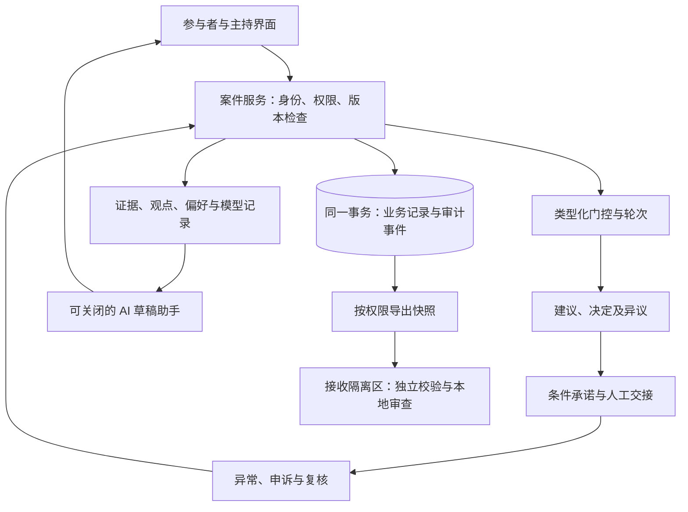

# 决策内核与卷宗契约 v0.5

日期：2026-11-05。状态：架构提案；只有文末列出的离线契约检查可运行，服务端工作流、身份认证、表决和履约均未实现。上位产品边界见 [治理协议](../governance-protocol.md)，任务顺序见 [开发方案](../development-plan.md)，研究依据见 [证据登记 G09–G20](../research/governance-evidence-2026-11-04.md)。

最近两轮执行契约及 PostgreSQL 依据集中于 [Batch 1 RC 候选](batch1-rc1-spec.md)。本文保留领域说明；SPEC_FROZEN、IMPL_CONFORMANT、PILOT_AUTHORIZED 分别登记，当前均未达成，不能将文档版本或离线检查当作准入结论。

本轮补充 [治理对象、动作与依赖](ontology-actions.md)：固定动作注册表、多维许可与版本依赖、参数方案分支、AI 草稿、模板及发布清单。它延续关系库与单体取舍；血缘图帮助定位影响，不成为新的暂停权威源。相应 FT/PT-13..20 仍待实现。

## 1. 本轮架构决定

| 决定 | 取舍与适用阶段 |
| --- | --- |
| 决策卷宗是核心交换单位 | 内部按实体和版本存储，导出特定时点的快照；不把整个案件存为一个不断覆写的大 JSON。 |
| 类型化门控与表决分离 | 表决不能补足缺失授权；门控结论也不能替代价值选择。先实现固定类型，不做任意规则引擎。 |
| 案件、申诉、保护令、工单分别管理状态，总体承诺独立 | 使用同一数据库事务协调，不采用微服务或全量事件溯源框架；审理进度不代替保护令效力，工单取消不解除原承诺。 |
| 冻结到决定轮次 | 新证据可以继续进入案件；影响当前轮次的变更必须使相关审查失效并重新开轮。 |
| 多模型展示先于自动优化 | 首版预算与维护模型可复算，显示分布与敏感性；RDM、DAPP 和 minimax regret 分阶段验证。 |
| 离线契约先实现一个窄配置 | `simulation_gate_review` 仅表达模拟案件的表决前审查。完整案卷、签名信封、联邦互认和执行协议另行实现。 |

现有 0.1.0 离线配置的验收目标：两类虚构案件可用同一契约表达；缺失权限、旧版本门控、未知证据和参与数据不一致不能被伪装为可开轮。格式正确但受阻的案件仍能保存和交换。检查通过不能证明事实、法律效力或代表性。

### 1.1 Batch 1 核心不变式与效力边界

凡改变参与资格、程序状态、资源配置或权利义务的决定与动作，均须绑定可解析、版本确定的 `MandateRef / EvidenceRef / ScopeSpec / RemedySpec`；生效或执行时重新核验相关权限与状态。缺失、过期、撤销或存在阻断性争议时，不得获得相应效力。批准、拒绝、暂停、取消、恢复及自动动作都受此约束；字段齐全不代表授权真实或动作正当。

| 类型 | 最小语义 | 生效核验 |
| --- | --- | --- |
| MandateRef | 授权文书/条款、授权者、受托主体、权能、版本与授权链 | 来源身份、授权链及当前状态；引用法律或协议哈希本身不赋权。 |
| EvidenceRef | 来源对象及版本、采集/生成方式、质量与局限；定量证据引用计量规范 | 依据可访问、适用、未被替换或存在未处理的阻断性争议；定性证词不强制量化。 |
| ScopeSpec | 对象、动作、事项、组织/空间边界、资源上限、有效时间与失效条件 | 该次动作匹配范围，交接时仍有效；不以初次核验代替当前检查。 |
| RemedySpec | 通知对象及送达方式、异议窗口、独立复核主体、停止/更正/补救与升级安排 | 渠道可访问、责任明确；不能回滚的后果必须说明，不虚构完全恢复能力。 |

用 `Draft / Submitted / Effective` 表达记录效力，独立于案件进展。四元组完整性约束的是进入具有相应效力的状态；举报、新证据和底线主张可在材料不全时按既定受理权限进入待审队列，不能因此取得决定权，也不能因尚无完整依据而禁止提出。拒绝或暂停同样必须引用其程序依据；全系统统一的受理/权限策略可以提供该依据，不能要求投诉者先取得被投诉者授权。

类型与 Schema 负责结构，服务端负责状态、权限和事务内复核，具名审查负责实际适用性。追溯降低和暴露越权风险，不保证彻底消除伪造、串谋、配置错误或高权限绕过。该完整契约尚未进入第 8 节的离线配置；当前校验器也不构成其运行时实现。

### 1.2 生命周期与案件模式的契约落实

AW-001 须用独立版本化 JSON Schema 表达客户端输入、服务端结果及导入记录，不能只有本文的类型说明。四元组字段及条件必填属于结构契约；引用可解析、当前授权、职责分离和保护令检查仍属于运行时与制度审查。

| 转换或模式 | 允许条件 | 不产生的效力 |
| --- | --- | --- |
| DRAFT → SUBMITTED | 基础受理规则、系统归属及 ACL 成立；领域材料可不完整，返回受理回执 | 不直接取得所请求的批准、阻断或执行资格。 |
| SUBMITTED → EFFECTIVE | 服务端组装完整 ActionEffectivenessEnvelope，事务内通过当前权限、版本、实例回避及其他适用门控 | Schema 通过或客户端自带回执不能代替核验。 |
| simulation | 演练与获准历史回放保留模拟标记，历史回放另记 historical_replay 用途 | 模拟状态转换不授予真实资源或权利义务效力。 |
| advisory | 形成咨询结论，按已授权规则管理自身程序 | 不自动转为 delegated 决定或执行授权。 |
| delegated | 另有真实且限定范围的授权及适用准入依据，逐动作重验 | 模式字段本身不授予权限，不继承历史演练中的授权。 |

`historical_replay` 是用途，不是第四种案件模式。无法核验的历史行为人使用 `UNMAPPED_HISTORICAL_ACTOR_NON_EXECUTABLE`，与导入者的真实认证身份分开记录；不伪造 member_id。该历史记录不能原地升级为 delegated，即使后来补齐身份映射也不追认执行权。真实行动另建关联案件并重新取得授权，参见 [RC 2.4](batch1-rc1-spec.md#24-实例级职责分离)。真实历史资料须单独核验使用许可，现有只接受 synthetic 的 0.1.0 配置不能直接承载。

## 2. 模块与信任边界



AI 无制度效力状态转换权限、无秘密选票读取权限、无执行连接器凭证。其 DRAFT 由应用受限服务保存，人类明确确认后才受理；服务身份与请求者分开留痕，不能继承请求者全部权能。检索材料和外部卷宗都是不可信输入，不能加载其中的脚本、远端 JSON-LD 上下文或工具指令。主持、维护、授权和独立复核的职责通过案件权限控制，不能用“管理员”一项角色替代。

首版数据访问按节点、共同体、案件、对象和用途检查；公共读取、当事人访问、审查访问与保密资料分别授权。来源实体、生成活动和责任主体的区分参考 PROV-O [G17]，当前不要求采用 RDF 或知识图谱数据库。

派生输出、提示/日志、缓存和导出同样保存输入限制；访问要求合取、用途取交集，来源确认和保存约束另记。逐次核验当前许可并检查案件策略版本，不能等异步血缘遍历完成才停止未授权展示。模型处理还须符合提供商/环境政策，人类可读不等于可出域给模型。跨案参与者画像默认禁止。

## 3. 版本、来源与冻结

领域对象通常具有来源节点、对象 ID、修订号、创建主体和时间；秘密 Ballot 明确不保存身份性创建者、逐票精确时间或插入序号，使用随机 UUIDv4。资格审计与票面访问隔离但耗权/写票仍原子提交，普通审计不直查选票基表及系统列，见 [RC 5.2](batch1-rc1-spec.md#52-秘密选票与私人偏好的审计例外)。引用使用对象 ID 与修订号，不能只指向一个会变的 URL。外部证据还记录采集方式、观察时间、附件可用性与质疑状态；链接存在不意味着内容真实。

| 记录 | 必须绑定的依据 | 依据改变后的处理 |
| --- | --- | --- |
| GateAssessment | 案件修订、规则、证据快照、审查主体及权限 | 标记失效，重新审查；不覆盖原记录。 |
| DecisionRound | 参与资格、宪章、选项、证据清单、计票规则、模型和 AI 输出版本 | 有权主体判断实质性；实质变更中止旧轮次，新轮次重新告知并确认。 |
| Decision / Mandate | 轮次、理由、少数意见、范围和期限 | 新决定或补充授权；不得静默重新绑定到新方案。 |
| TranslationApproval | 原文修订、译文修订、本人或明确代理、确认时间与发布范围 | 任一文本改变，重新确认；撤回后停止后续发布并保留最小受控审计。 |
| ExportSnapshot | 内容版本、导出时间、状态观察时间、遮盖和用途 | 新导出独立成包；旧包仅证明它所记载的历史状态。 |

案件可追加新证据、申诉与更正；冻结的是轮次的依据集合。勘误也留痕，其是否需要重新审议由已公布规则决定。安全修复可以中止轮次，不能以热更新悄悄改变投票语义。

立项、审议、冻结、监测、修正/归档可作为界面阶段，但不合并案件、申诉、保护令、工单和承诺的状态。底线、计量口径、预算或方案发生实质变化时，相关条件同意/预签署标为待重新确认；冻结后中止旧轮次并重开。新决定以 `supersedes` 关联被替代版本，既往事实不覆盖；Schema 版本、案件修订和决定轮次编号互不替代。

普通关系表保留版本及审计事件即可。更新命令附预期版本；幂等键限定共同体、认证主体和命令类型，原键携带不同内容必须拒绝。成功转换的核验回执、业务版本和 APPLIED 审计同事务提交；规则拒绝不修改目标业务，系统故障另记诊断，COMMIT 结果未知先核对。完整重试语义见 [RC 三路审计契约](batch1-rc1-spec.md#5-三路审计幂等与不确定结果)。

服务端从认证上下文生成调用主体及核验回执，不接收客户端自证。命令独立短事务预登记后，主事务与核对器共用唯一命令行锁及 attempt/generation 检查，再进入授权链、案件等领域锁；连接断开不证明回滚，详见 [RC 5.1](batch1-rc1-spec.md#51-命令预登记与结果核对)。所有保护令写入与交接共用案件行锁，锁后重新查询当前状态；仅锁已有保护令不能防止空集合上新增保护令。具体隔离级别、锁序、时间检查及远端状态限制见 [RC 并发契约](batch1-rc1-spec.md#3-postgresql-事务与并发边界)，尚待真实 PostgreSQL 验证。

此处追加事件用于审计，不要求通过事件重放重建全部业务状态。完整 Event Sourcing 只有在需求明确后另行评估事件演进、重放和投影一致性。追加历史不意味着敏感原文永久公开或无法依保存策略处理。

核心命令先定义以下契约，再选择 HTTP 路由；调用者身份从服务端认证上下文取得，不能相信请求自填的 `actor_id`。下面均为待实现的应用契约，不是离线工具接口：

| 命令 | 发起者与前置检查 | 成功结果 / 失败处理 |
| --- | --- | --- |
| `RecordGateAssessment` | 具有相应门控评估权的审查者；版本、范围、回避及证据检查 | 新评估与审计事件；超范围拒绝，旧版本冲突，缺证据仅允许未完成记录。 |
| `FreezeRound` | 获授权主持者；当前必需门控、参与及约束处理完成 | 冻结依据和资格快照；缺失或过期返回结构化阻塞清单，不开启投票。 |
| `PublishTranslation` | 发言者或已获授权代理确认精确文本版本 | 按批准范围发布；文本变化或许可撤回拒绝旧确认。 |
| `RequestHandoff` | 承诺执行责任人；决定版本、有效授权、条件、资源、救济/暂停检查 | 授权通过只形成有期限的 READY_FOR_HANDOFF；实际人工交接及外部回执另行记录，交接前重验。 |
| `RecordIncident` | 当事人、监测源或审查者按各自范围提交 | 追加信号/投诉及通知任务；不自动生成责任结论。 |
| `IssueProtectiveOrder` | 具有相应临时保护权的主体；对象、范围、期限、理由及复核安排 | 记录限定措施；无相应权限则保留请求并转介，不执行措施。 |

阻塞结果包括稳定原因码、受影响对象、待补材料和复核入口；公开返回只包含调用者获准查看的原因，避免错误信息泄露敏感证据。通知发送与事务提交分离，先持久记录待通知项，再由可重试任务发送；发送失败不等于已送达，也不回滚已经形成的案件事实。真实外部连接器以后增加投递、回执与对账协议，不声称数据库事务覆盖外部世界。

上述命令收录为代码内固定注册表，Action ID、权限集合和处理器分开，必需校验与锁序不可由配置关闭。Outbox 与成功业务同事务保存受控引用，消费时重验收件权限及最新许可，重试不重复产生制度效力。详见 [动作及 Outbox 约束](ontology-actions.md#2-固定动作注册表与事务后工作)。

实例级职责分离使用共同体内核验的成员关联及已公布规则；授权、实际交接、回执上传与 VERIFY_EXECUTION_RECEIPT 核验不混为同一动作。申诉回避取与被申诉行为相关且有依据的责任集合，不排除所有上游证据作者，具体互斥见 [RC 2.4](batch1-rc1-spec.md#24-实例级职责分离)。许可撤回和输出共用案件锁及 access_policy_version，保证限于本地放行顺序，不扩展为外部送达原子性。导出先在私有存储完成文件，短事务只登记 PUBLISHED_LOCAL 元数据；每次下载再查当前许可，发布不等于永久开放。

## 4. 类型化门控、底线与参与质量

### 4.1 门控记录与程序权限

`GateAssessment` 至少记录类型、适用动作、是否必需、`pass / fail / unknown / not_applicable`、审查者、授权引用、依据版本、理由、观察时间、有效期和质疑渠道。缺失记录视为 `unknown`；必需门控只有有效的 `pass` 才放行。`not_applicable` 须说明依据，不能替代必需检查。

| 门控 | 谁负责、依据什么 | 不产生的权力 |
| --- | --- | --- |
| 参与程序 participation | 获授权的程序审查者核对预先公布的招募、支持及遗漏处置要求 | 响应率达标不证明代表性；不得强迫参与或事后修改分母。 |
| 证据与模型 evidence | 专业审查者核对方法、适用域、不确定性和利益冲突 | 不能据专业身份决定社会应接受何种风险。 |
| 底线适用 constraints | 有明确权限的审查者判断约束来源、适用范围和冲突处置 | 不把个人提出的底线自动升级为无限否决权。 |
| 特定同意 consent | 被规则明确赋予同意权的主体，针对具体事项和版本 | 不能替其他受影响者同意，不能豁免适用的外部强制规则。 |
| 授权范围 mandate | 受托或法定主体及核验者确认具体动作、对象、资源、期限 | 不授予主体原本不拥有的预算、司法或监管权。 |

MVP 首先固定表决前的 `participation / constraints / mandate` 三项必需门控；`mandate` 此处仅检查启动该程序的权限。专业审查和特定同意按案件模板增加，绝不能把此三项推广为高风险实验的充分条件。履约交接另行检查执行授权、条件、资源与暂停。

### 4.2 底线不是单一布尔值

`Constraint` 区分来源 `applicable_law / adopted_charter / participant_claim`，以及适用处理状态 `asserted / contested / adopted / inapplicable`。保存提出者、文本、来源、适用对象、判断理由和申诉途径。`adopted` 表示本程序已采纳为适用约束，不意味着平台创造或批准了一条法律；法律的效力也不以软件中的采纳状态为前提。

完整 Batch 1 契约进一步区分三类程序效力；以下是待实现的语义分类，不是对 0.1.0 枚举的静默改名：

| 分类 | 效力及变更 | 异议处理 |
| --- | --- | --- |
| BINDING_EXTERNAL | 已适用的外部强制规则或既有基础章程；本案投票不得自行豁免 | 记录文书性质、适用范围、具名审查和外部救济；法定义务与组织自设规则不混同。 |
| CASE_RATIFIED | 按本案有效程序采纳的硬约束；修改须重走适用门限并使相关签署待重确认 | 可据新证据重开，不能用简单计分绕过。 |
| PROPOSED_CLAIM | 待审主张，触发适用资格审查，不自动取得一票否决权 | 未采纳时另记理由、正式保留意见及是否愿意权衡；不自动降为可交易偏好。 |

“未采纳为本案约束”与“在本案不适用”应在完整契约中分别表达；采用 `NOT_ADOPTED_AS_CASE_CONSTRAINT` 之类的处理结果，不使用 `REJECTED_TO_TRADEOFF_POOL` 代替当事人选择。重大未列明权益需有权程序确认或转介，不能由专家单方升级为共同体已批准的约束。新分类、处理状态与旧格式之间需显式迁移规则，未经区分的旧记录不能推断成新状态。

已经确认适用的底线先筛选可行方案，再比较可交易目标。未处理的适用性争议应进入审查，不能默认不适用。底线冲突或可行集为空时，输出“需补充权限／修订方案／暂缓／外部转介／无协议”；不强制运行 QV。词典序优先关系必须由有权程序明确，不能因为字段名称叫“底线”就自动支配其他权利。

专家披露指标选择、模型边界和价值假设；“事实与价值分开记录”不意味着科学建模没有规范性选择。投票簇相关性只能作为审查线索，不能自动证明串谋或剔除选民。

专家输出还包含证据质量依据及同行分歧。若采用领域评级框架，必须注明框架、版本、适用对象和理由；不得把不同框架的证据质量、结论信心与概率折成通用的专家权威分数。

### 4.3 InclusionAudit 的可操作口径

记录目标母体、抽样框及覆盖缺口、招募方式、分层口径、邀请数、回应数、实际参与数、时间窗口、辅助措施和局限。未知母体或邀请分母明确留空；重叠群体分别报告，不能直接相加。回应招募、参与审议、投票和弃权是不同事件。

门控判断依据预先确认的程序要求与补救情况，不硬编码“60% 即代表性充分”。响应率只能是诊断信息，不能单独证明未响应偏差大小。[G09] 未达要求时生成补充邀请、线下协助、延长或转介记录，并设复核时间；自愿不参加不能成为无限期强迫招募的理由。调整参与规则必须版本化，不能事后降低门槛使当前结果过关。小群体统计在公开导出时抑制或合并，并说明信息缺失。

完整参与审计另记录明确拒绝、未触达、退出和未知处置；状态定义与统计时点明确，同一阶段去重，不能从未回应推定知情弃权。`eligible_population` 可未知，缺少分母不能填零。补救窗口、最长待处理时间和复核责任预先规定；期限到达进入升级、暂缓、终止本轮或咨询程序，不自动放行。只有预先授权允许处理的程序性缺口，才可经具名审查披露局限后继续；紧急协议也不能作为通用开关绕过必要同意、适用底线或授权。

## 5. AI 保真与多模型比较

原文在其获准范围内保留；AI 译文是草稿，经本人或有明确范围的代理确认后才发布，并列显示原文入口和修订信息。不能取得确认时可以保留待确认草稿；不能冒充当事人立场。集体陈述需记录认可的代表程序，个别成员点击不等于整个群体确认。

`SpeakerStatementRecord` 将原文/译文发布许可、表达准确性确认、表决实质性复核分成独立版本记录；确认绑定精确文本、主体、代理范围和时间。冻结后仍可纠正误译或撤回许可，停止未获准展示；回退原文须有原文许可。实质性裁定不自动赋予签发保护令的权力，普通评论撤回也不自动停票。已发布内容的回收能力和受限历史保存分别说明，不能承诺抹除所有外部副本。

恐惧、屈辱与历史伤害可以作为证词内容保留。情绪标签仅在必要且经适当许可时使用，允许本人纠正；不自动推断心理状态或提高政治权重。内容处置还需覆盖隐私泄露、针对性骚扰、虚假冒充及其他适用规则，保留申诉；不能把“保留情绪”误解为所有文本必须公开。

`CruxRecord` 可同时标记事实、因果、模型结构、价值、权限或程序争议，不强制互斥四象限。可检验争点记录双方愿意据以更新判断的证据；这是一项当事人声明，不是系统强制改变态度的条件。

`ModelRun` 记录模型及输入版本、单位、空间/时间范围、情景、适用域、参数、计算结果、缺失值和复现条件。分布来自统计估计、专家判断还是探索情景须分别注明；探索情景数量不能解释为事件概率。

RDM 是面对深度不确定性的分析方法族，不等同 minimax regret；DAPP 由 Deltares 与 TU Delft 等发展，强调随变化调整的路径。[G10]、[G11]、[G12] 首版只做并列成本/维护计算、约束违反和敏感性展示。以后使用 regret 时，必须先约定损失函数、可比较尺度、基准方案、情景集合和不确定性范围；不把不同人的损失默认相加。最小最大后悔值仍可能违反绝对安全底线，必须先做约束检查。

自适应路径需区分：政策无法满足目标的临界点、考虑行动提前量的决策触发点、实际切换授权。模型可能遗漏共同失效模式；多模型一致也不等于安全保证。

方案分支复用 Option/ScenarioRun，固定基线并记录参数差异，比较“方案 × 模型 × 指标 × 群体”。基线更新显式生成新版本，冻结轮次不自动 rebase；分支不能覆写已生效约束或许可。通过筛查仍需其他门控、决定及创建承诺的独立授权，不提供任意分支一键合并生效。

比较顺序固定为：先检查已确认底线；再按明确的物理/业务尺度展示各模型结果；并列保留不同主体的评价；最后定义阶段行动、监测和后续切换条件。首版只表达静态路径与人工复核，不建设重型仿真引擎。模型预测越界属于潜在不满足约束，不能直接判现实违规；越界情景数及分母、选取方法与缺失情景一并披露，不能把探索集合频率当成风险概率。

## 6. 异议预警与正当程序

### 6.1 从异议到信号

`Dissent` 保存理由和未量化异议；提出者可选填 `Signpost`，不能因无法给出量化预测就失去异议资格。预警至少包含：

| 字段组 | 约定 |
| --- | --- |
| 指标口径 | 指标 ID、单位、参考基准、方向、阈值、时间窗口与聚合方式；例如“维护工时每周总量”，不能只写“水位低于 12m”。 |
| 观测质量 | 来源、采样周期、有效覆盖率、迟到/缺失/过期容忍、来源冲突处理、校准或人工复核要求。 |
| 程序后果 | 默认仅建立复核请求；有预先有效授权时才申请或执行限定范围的临时保护。 |
| 责任与期限 | 观察负责人、通知对象、响应期限、复核者、保护到期及恢复条件。 |

`ObservableMetricSpec` 还须区分物质/物理口径、参照基准与聚合逻辑。保留原始高频观测，以固定 UTC 分桶计算有效覆盖及首、中、尾缺口；单日密集采样不能抵扣其他时段。阈值方向对应上界、下界或区间判据，注明不确定性的计算方法；桶内统计不证明每一时刻安全。安全底线不默认插值放行，详细规则见 [RC 计量契约](batch1-rc1-spec.md#61-时间分桶与方向判定)。

计量示例：WHO 2022 资料给出的硝酸盐指导值为 50 mg/L（以硝酸根计），按 0.226 换算约为 11.3 mg/L（以氮计）；该换算不是本平台设定的现场限值，具体案件另核适用标准。[G20] 地下水位高程与地下水埋深使用不同参照和方向，必须记录测点、基准面及其版本；不能仅写“低于 12m”。定性异议仍可独立保留，不要求都变为计量对象。

信号状态使用 `insufficient_data / normal / threshold_crossed / source_conflict`。越线是重新审查的证据，不等于预测已获证实、发生违约或存在过错。数据缺失不解释为正常，也不能自动触发罚没。重复信号合并到同一事件，保留首次、末次观测和证据修订。

### 6.2 并行状态与总体承诺

| 对象 | 主要状态 | 关键边界 |
| --- | --- | --- |
| Case | 立项、审议、冻结、决定、关闭；可无协议或开启新轮次 | 案件关闭不代表所有承诺完成；申诉任何阶段均可提出。 |
| Appeal | 提交、受理审查、审理、解决 | 仅记录进度；获准暂缓须关联独立保护令。 |
| ProtectiveOrder | 生效、到期失效、被解除、被新令替代 | 任一适用有效令即阻断；解除一个不消除其他令。 |
| FulfillmentTicket | 排队、受阻、就绪、已人工交接、外部回执已录入、取消 | 就绪不等于交接，回执不等于结果已核实；已交接不再受内部工单暂停控制。 |
| Commitment | 有效、部分履行、完成、经修订终止 | 总体义务与工单安排分离；取消工单不自动解除义务或记为已履行。 |

`ProtectiveOrder` 记录有权签发者、四元组、对象及后代覆盖范围、动作、开始/到期、复核期限及送达。它是临时暂停效力的唯一权威源，申诉进度不产生该效力；授权、资源、资格和阶段条件仍独立检查。具体枚举及转换边界见 [RC 并行状态契约](batch1-rc1-spec.md#4-单一保护令权威源与并行状态)。

版本化血缘保存派生输入和具名确认的实质性引用；变更只产生影响清单、展示限制或复核请求，不自行签发保护令。无依赖边不证明不存在实质性影响，遗漏仍可申诉。派生子图防环，一般讨论关系可有环；图的节点、边及计数也受隐私权限控制，见 [依赖处置](ontology-actions.md#4-版本化依赖图与影响处置)。

正常争议先通知、提供可访问的证据和回应/补救机会，再独立审查。紧急情形可依预先授权先做必要且范围最小、优先可恢复的保护，同时补充通知和及时复核；水电救援等基本保障不能随普通预算争议自动切断。平台不替代现场既有应急权责。

保护轨道与事实核验/责任认定轨道并行：保护不推定过错，最终处分需独立程序和对应权限。暂缓可在技术上撤销，造成的收入损失或延期未必可逆，不以 `FULLY_REVERSIBLE_HOLD` 标签证明无害。预设动作绑定四元组、允许操作清单、受控对象、已知副作用、最长期限、升级责任和恢复条件；未知外部状态先核对，不无限重试。

Batch 1 只处理平台内未交接工单的限时暂缓、通知和人工复核。真实试点须 G4 放行，实际付款/取消由财务受托人处理；工单状态不表示银行资金已冻结。真实资产扣划、外部 API 熔断和自动处罚留在 Batch 2，另经权限、故障与对账验收。

期限从规则指定且可证明的送达事件计算；语言和访问障碍、送达失败进入人工处理，不能一概按上传时间倒计时。争议金额保全也需要相应权限，不是默认功能。数据源错误、不可抗力或责任争议分别审查；不能自动判免责或自动没收。

复核结论必须具名、给理由、适用范围与救济路径。到期旧令失去阻断力并生成升级待办，即使到期任务延迟也不得继续用旧令冻结。新交接重新核对当前授权、条件、证据及其他保护令；全部通过可继续，不必等待旧令的人工解除。延长保护需新有效授权和新令，不以未处理工单无限延长。Batch 1 先用合成案例演练，真实试点仍需 PILOT_AUTHORIZED，无自动划扣。

## 7. 身份、互认、冲突与迁移

凭证信任策略区分签发者获准主张的属性、证据质量、有效期、撤销和申诉。多源背书可能存在共同控制或排斥无正式证件者，应记录独立性与替代渠道；不能因一个签发者被调查就自动剥夺所有持证者的权利。冻结新授权与复核既往决定分别处理。

MACI 具有协调者及结果发布的信任/可用性假设。[G13] 本产品不据此承诺抗持续设备控制、现实威胁或无法私下改票的情形；这是威胁模型边界，不是已完成攻击实验。MVP 先完成秘密投票的访问控制及人工参与保护，MACI/ZKP 作为独立后续试验。

互认是一条接收方签署的有限决定：来源、对象类型、事项、版本、有效期、允许用途、核验时点和撤回方式。输出可为 `accept_as_evidence / accept_for_named_purpose / manual_review / reject`，不使用一个全局 `trusted=true`。来源声明符合程序不等于程序真实发生；核验需要可访问证据、适当抽检及责任主体。

适用法、审理机构/程序、决定承认与执行地点分别配置。HCCH 的相关原则针对国际商事合同，不能直接套作所有共同体的准据法。[G14] “影响地优先”只能是待核验的协作政策提案；“最严格标准”只有在尺度、对象与条件可比较时才有意义。冲突无法合并时转人工联合程序，不能三选一就自称解决冲突法。

迁移分两阶段：授权导出受限快照并隔离导入；完成接收主体、成员资格、密钥、状态新鲜度、外部托管和未履行义务核验后，才考虑恢复操作。普通成员不能导出全体私密资料。迁移不继承外部账户、法律地位或撤销后的权限；未决承诺不得被两个活跃节点重复履行，须有移交生效时点及旧端停止新交接的证据。节点失联时允许恢复只读协作，不承诺无缝恢复真实执行。

Batch 1 的 `RecoveryManifest` 为每项记录/依赖列出以下独立结果，不把“文件已恢复”合并为“可执行”：

| 维度 | 结果及后续责任 |
| --- | --- |
| 资料恢复 | 恢复、缺失、按权限遮盖；记录版本、摘要核验及缺件原因。 |
| 来源验证 | Batch 1 明示 NOT_SIGNED_BATCH1_BASELINE；其他签名方案未支持时隔离。摘要匹配不认证来源，须另核可信归档来源。 |
| 当前效力 | 待核验、仍有效、到期、撤回或有争议；附核验时点、依据和责任人。 |
| 外部重绑定 | 不需要、待确认、需要重绑定或已确认；银行、API、传感器权限与主体资格分别核验。 |

服务器搬迁不自动使所有授权和仲裁安排失效，也不自动继承它们。只暂停受未核验依赖影响的动作；无关且已获准的只读访问可继续。完整跨节点认证及活跃执行移交属于 Batch 2，本批先完成清单生成与人工恢复演练。

公开制度层、受限审计层及隔离的身份/秘密选票关联分别导出；加密钥匙或多签方案不能取代访问授权。保存、销毁和例外保留按资料类别、目的、申诉需要与适用要求制定，不统一宣称所有历史永久保留或申诉期后全部销毁。哈希和承诺也须检查关联泄露风险。

## 8. Case Packet 离线配置与检查边界

现有 [JSON Schema](../../specs/case-packet.schema.json) 和 [校验工具](../../scripts/validate_case_packet.py) 的 `schema_version=0.1.0` 是试验性数据格式版本，与文档版本独立；不是完整治理协议发布。配置 `simulation_gate_review` 是 Case Packet 的表决前快照子集：

| 字段 | 本配置的含义 |
| --- | --- |
| 来源、案件、版本、导出时间 | 来源命名空间中的快照身份；不认证来源。时间只接受 UTC 秒精度 `YYYY-MM-DDTHH:MM:SSZ`。 |
| `mode / data_classification / execution_enabled` | 固定为 `simulation / synthetic / false`；真实材料另定义配置，不能改字段就升级执行。 |
| `charter_ref / rules_ref / evidence` | 自包含的虚构证据条目及版本引用；不抓取外部资源。 |
| `authority_records` | 本案中评估门控的模拟授权、主体、权能、有效期和依据；不表示现实授权已核验。 |
| `inclusion_audit` | 招募数据、覆盖局限与辅助措施；不由校验器判定代表性。 |
| `constraints` | 来源类型、适用状态及处理理由引用；不由校验器判断法律或伦理正确性。 |
| `gates / review_status` | 三类表决前必需门控及案件版本；`ready_for_round` 仅为可开启模拟轮次的记录声明。 |

完整案例中的选项、私人偏好、译文确认、模型运行、选票、决定、异议、承诺、申诉、附件清单和签名尚不在此配置内。它们不能塞入未声明字段；后续增加明确配置及迁移规则。此配置也不接受真实资料或声称完整案卷。

完整四元组、效力状态、三级约束分类、计量规范、恢复清单及 RC 服务端执行契约均为 Batch 1 待实现目标。Schema 仍为 0.1.0，已有正反例未因此升级；后续新增配置需单独验证和显式迁移，不把当前 `VALID` 当作新规范已满足。

离线工具分两层：JSON Schema Draft 2020-12 检查必填项、类型、枚举及封闭字段；本地语义检查核对唯一 ID、引用版本、计数关系、门控种类与权限、时效和审查状态一致性。尚为 `asserted / contested` 的约束不能同时声明 `ready_for_round`，须先记录适用处理；这要求程序回应主张，不赋予提出者永久否决权。受阻和审查中的快照可保留历史评估，其旧版本或撤回权限不得再用于放行。拒绝重复 JSON 键及非有限数值，显式检查时间格式。[G15] 只使用仓库内固定 Schema，实例不能指定远端 Schema。它不判断文本事实、不执行动作、不证明审查人身份、不扫描任意文本内是否藏有个人资料；`synthetic` 是作者声明，真实数据不得输入此练习工具。

`VALID` 表示结构及上述有限一致性成立；`blocked` 或 `in_review` 快照也可以有效。完整性清单、来源签名、密钥管理和当前撤销状态尚未实现。将来选择标准签名封装时另固定规范化方案，普通 JSON 排序不宣称符合 JCS。[G16] 快照版本引用也不能替代内容摘要或来源认证。

```sh
python3 -m pip install -r requirements-validation.txt
python3 scripts/validate_case_packet.py examples/consortium-review.json examples/floating-review-blocked.json
python3 -m unittest discover -s tests -v
```

校验依赖 `jsonschema==4.23.0`，用于标准 Schema 验证；本轮复用本机已有安装，未安装新包。跨字段检查与测试使用 Python 标准库。该 Python 工具是独立规范夹具，不决定应用后端语言，也不是面向恶意大型上传的生产接收服务。

2026-11-04 上一轮离线实现的验证记录：两份样例通过本地检查，9 个 `unittest` 测试方法通过，包含越权/过期/旧版本、未处理约束、错误引用和重复 JSON 键等反例。未处理约束被错误标为可开轮的问题先由失败测试复现，再修正通过。本次文档合并未修改或重跑该实现；此记录不构成新增 Batch 1 契约、运行流程、签名或实际治理效果的验证。

### 8.1 0.1.0 迁移说明的必备对照

以下固定迁移原则；目标完整 Schema 尚待交付，不能把此表当作已运行的转换器。保留原包及来源版本，另建目标记录；对每一字段明确复制、显式转换、待补录或仅历史保留，不修改原快照来伪装新契约通过。

| 0.1.0 来源字段 | 目标契约中的处理要求 | 禁止推断或自动补齐 |
| --- | --- | --- |
| schema_version / profile / source_node_id / case_id / case_version | 保存源配置与对象版本映射，另记目标契约版本 | 不将格式升级解释为来源认证、程序承认或新执行资格。 |
| mode / data_classification / execution_enabled | 保持 simulation / synthetic / false 的来源事实；目标仍为模拟范围 | 不把 simulation 转 delegated；不将合成资料改成真实历史。 |
| charter_ref / rules_ref / evidence | 保留原始引用与精确修订、合成来源及内容；新增摘要如实记录生成方法 | 原引用不自动成为已核实的授权文件或真实证词。 |
| authority_records / actor_id | 保留为模拟授权声明及来源角色引用；与本地认证主体、member_id 映射分别记录 | 不生成 VERIFIED_ACTIVE 在线核验回执，不伪造实名关联。 |
| constraints 的 kind / status / disposition_ref | 分别保留来源分类、适用处理及原理由；新三级效力分类须按目标规则重新确认 | adopted 不自动映射为具备完整信封的 EFFECTIVE 或 CASE_RATIFIED。 |
| inclusion_audit / gates / review_status | 保留抽样计数、未知分母及原门控结果；目标增加的字段列待补录 | 不凭 ready_for_round 生成新的冻结决定，不把未回应补成自愿弃权。 |
| 原配置未含的选票、译文确认、四元组救济及履行记录 | 显式列为缺件或不适用并给依据；阻断缺件影响的效力转换 | 不生成“默认同意”、本人确认、真实履行或虚构救济机构来满足 Schema。 |

完整迁移交付还须有目标字段级映射及正反夹具：合法模拟导入、缺字段保留待补、错误引用/版本冲突隔离、尝试升级真实效力被拒。Golden Fixtures 在原 FT/PT 测试族下标识初态、命令、预期结果与业务/审计/幂等/Outbox 后置断言；并发另列屏障及故障步骤。此处未新增运行时测试，完整交付与冻结证据见 [RC 9.1](batch1-rc1-spec.md#91-aw-001-配套交付与冻结检查)。

## 9. 后续开发验收与顺序

| 风险或失败样例 | 验收行为 | 阶段 |
| --- | --- | --- |
| 旧版审查结果配上新方案 | 拒绝标记可开轮，保留原审查 | 本轮离线检查；AW-002 服务端再验证。 |
| 参与门控未通过但总票数很多 | 不能越过必需门控；说明补救及复核责任 | 本轮检查状态一致性；AW-002/004 实现流程。 |
| 签署者不拥有该类审查权、权限到期 | 不能把门控作为有效通行依据 | 本轮检查声明一致性；身份与真实性在 AW-002。 |
| 原文或译文变更后仍沿用旧确认 | 新版本不公开，等待重新确认 | AW-003/008；本轮未实现。 |
| 观测过期、相互冲突或重复 | 保留异常和复核请求，不自动定责或重复行动 | AW-006/013；本轮未实现。 |
| 临时保护到期而风险未复核 | 旧令失效并升级；新交接独立核验，满足条件可继续，延期须新授权新令 | AW-006/013；本轮未实现。 |
| 冻结/撤销与交接并发 | 同一事务内重新验证；已发生的行动进入对账和救济 | AW-005/013；本轮未实现。 |
| 未获授权导出、旧包覆盖新状态、迁移双重履约 | 最小化导出、隔离接收、版本及移交审查 | AW-006/015；本轮未实现。 |

上述领域风险与 [RC FT/PT-01..20](batch1-rc1-spec.md#8-正反成对验收矩阵) 共同验收，任务映射见 [开发方案 12.1](../development-plan.md#121-batch-1-必须补齐的失败验收)；新增服务端测试均未实现。历史影子回放须先核对材料使用权限，区分当时信息与事后补充；未经本人确认的转译明确标记。真实小额试点仍须独立放行，不能从回放成功推定现实治理有效或风险为零。

先完成 AW-001 的完整样例与人工走查，再实现无 AI 的 AW-002/003。首版保留人工判断与理由记录，把误授权和异议遗漏作为首要失败指标；实测后再决定增加复杂机制。工期须按新增门控和处置流程重新估算，离线检查通过不算 G0 或 G1 整体放行。

[G09]: https://aapor.org/standards-and-ethics/standard-definitions/
[G10]: https://link.springer.com/chapter/10.1007/978-3-030-05252-2_2
[G11]: https://www.deltares.nl/en/expertise/areas-of-expertise/sea-level-rise/dynamic-adaptive-policy-pathways
[G12]: https://doi.org/10.1016/j.gloenvcha.2012.12.006
[G13]: https://pse.dev/articles/state-of-private-voting-2026/state-of-private-voting-2026-v2.pdf
[G14]: https://www.hcch.net/en/instruments/conventions/full-text/?cid=135
[G15]: https://json-schema.org/draft/2020-12/json-schema-validation
[G16]: https://www.rfc-editor.org/rfc/rfc8785.html
[G17]: https://www.w3.org/TR/prov-o/
[G20]: https://www.who.int/publications/m/item/chemical-fact-sheets--nitrate-nitrite
