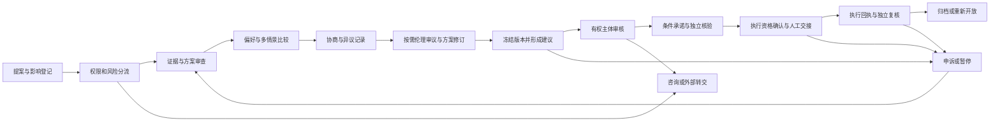

# AxioWeave 开发方案：多中心治理协作平台 v0.7

日期：2026-11-05。状态：主产品架构草案，已有离线卷宗契约检查；应用流程尚未实现、尚未取得真实试点授权、尚未验证治理效果。

配套：[产品与文档入口](../README.md)、[治理协议与节点互操作](governance-protocol.md)、[主产品机制调研](research/governance-evidence-2026-11-04.md)、[浮动社区场景](scenarios/seasteading.md)。下文的组织安排、规模、工期、技术选择和验收线均为本项目提案，不是既有合作承诺或学术共识。

本轮将“授权—证据—范围—救济”确立为核心不变式，并明确 Batch 1 / Batch 2 边界；详细契约见 [决策内核](architecture/decision-kernel.md)。这是开发基准草案，仍需完整样例、人工走查和行为测试。可运行的 `simulation_gate_review` 0.1.0 仅是表决前快照子集，尚未实现完整四元组、救济或运行时授权核验，不代表 AW-001 或 G0 整体完成。

最近两轮讨论整合为 [Batch 1 契约候选 v1.0-RC1-Spec](architecture/batch1-rc1-spec.md)，集中定义服务端核验回执、案件互斥锁、保护令、三路审计、幂等及 FT/PT-01..12。`SPEC_FROZEN / IMPL_CONFORMANT / PILOT_AUTHORIZED` 是三个独立关口。评审人已在 `8ba8cfe` 上签署 `SPEC_FROZEN=GRANTED` 与 `IMPL_CONFORMANT=GRANTED_SCOPED`，`PILOT_AUTHORIZED` 仍未授予；当前 HEAD 的新增加固不在该签名范围内。以下新增要求均为待实现，不将现有 9 项离线测试解释为服务端合规证据。

本轮经 [Palantir 官方资料核查](research/governance-evidence-2026-11-04.md#7-palantir-产品机制核查与适用边界)，增加 [治理对象、动作与依赖设计](architecture/ontology-actions.md)，将固定动作注册表、案件内血缘、多维许可、方案分支、AI 草稿和模板交付纳入候选；追加 FT/PT-13..20。仅借鉴工程机制，不引入 Palantir 产品或将其概括为只能服务单一主权。新增需求须进入冻结清单及 G0 估算。

v0.7 对 AW-001/G0 做实现收口：补齐秘密选票审计例外、底线与表决依赖、命令预登记及未知提交核对、许可撤回与本地输出锁协议、实例级职责分离和极简界面。保留现有任务编号及 FT/PT-01..20，只增加既有测试族的子场景；不扩大产品范围，也不据此将 G0 标为完成。

## 1. 产品定位与成功标准

AxioWeave 是用于人类主观权衡、多方协商、民主治理与伦理仲裁的协作平台。目标是帮助拥有不同价值观和权限的共同体，在保留异议的情况下形成可理解、可授权、可执行、可复核的共同决定，并逐步建立 AI 介导的多中心治理协议网。

产品服务共同体成员与受影响者、主持人、专业审查者、获授权决策者、执行者和独立复核者。科研联盟、开源共同体、合作社、城市合作及浮动社区共享核心流程，各自选择适用的代表、决策及救济规则。国家身份、海域、船旗和居住资格均不是通用参与前提。

**首版成功标准**：在一个节点中，一个低风险跨组织公共项目议题能完成目标与偏好表达、方案比较、协商和异议、基线表决、咨询性伦理审议、人工授权、条件承诺、执行回执与复核，并导出可校验案卷。独立复核者能重建依据、版本和责任；无有效授权或存在暂停的行动不能获得执行资格。以虚构数据验收时全部保持模拟，不把演练签署当成真实授权。

首版以单节点实现核心闭环，用两类虚构场景检查可迁移性；第二阶段才实现独立节点的有限互认。完成这些工程验证不证明 AI 更公正、跨文明治理有效或具有全球政治代表性。

明确三类验证：

- 软件可靠性：权限、计票、版本、审计和恢复测试通过。
- 运行合法性：具体机构确认内部授权和外部许可；平台状态不能自行产生法律效力。
- 治理有效性：与明确对照比较参与体验、理解、异议保留及执行效果，报告失败与不确定性。

## 2. 产品能力与实现阶段

| 主产品能力 | MVP 实现 | 后续扩展与边界 |
| --- | --- | --- |
| 主体、代表与权限 | 社区成员核验、受影响者登记、回避、角色和授权记录。 | 抽签、多院制、隐私凭证与液态委托分别试验；不自动按受影响度赋权。 |
| 主观权衡 | 目标、底线、排序、可接受范围和可选个人权重；展示方案的分布影响。 | 不把不同人的分数求和为统一痛感，也不保证帕累托最优。 |
| 协商与认知对齐 | 原文、人工/AI 摘要、译文确认、共同点、分歧和条件方案。 | 规模适合时评估 Polis；跨文化理解以参与者确认和测试为准。 |
| 后果比较 | 首个预算/维护成本模型、多个假设情景、敏感性与缺失数据提示。 | 后续加入经验证的专业模型；不建立一个垄断事实解释的通用世界模型。 |
| 民主治理 | 一人一票基线、冻结规则、资格快照及申诉。 | QV 先影子比较，多院规则、委托和 QF 逐项验证。 |
| 伦理审议与仲裁 | 争点、回避、证据质疑、理由、少数意见和咨询性结论。 | 真实约束性仲裁另行核验授权、适用程序与专业支持。 |
| 条件承诺与履约 | 有条件义务、时限、证据、人工核验和虚构回执；暂停及失败记录。 | 可控资源的自动履约连接器另设阶段，不自动制裁外部主体。 |
| 多中心协议网 | 来源与版本明确的案卷导出、本地校验、规则变更记录。 | 两节点有限互认、撤回和迁移；不产生全球终审权。 |

### 2.1 两批次研发边界

Batch 1 以单节点、人工判断和受限工单流程为基准；先完成模拟验收，真实低风险试点仍须 G4 单独放行。Batch 2 按组件分别立项、评估和验收，不因 Batch 1 完成而自动批准。

| 维度 | Batch 1：近期基准 | Batch 2：独立评估后扩展 |
| --- | --- | --- |
| 身份与参与 | 人工名册核验、分层参与审计、未知分母、限时补救与升级 | MACI/ZKP、多签发者网络；明确协调者、终端受控及恢复的威胁模型。 |
| 认知与表达 | 多标签分歧、版本化译文确认及撤回、原文与异议保留，AI 可关闭 | 多语种自动聚类；先有特定共同体的人类评估基准。 |
| 底线与权衡 | 三级约束适用审议、静态/简单情景比较、多主体独立评价 | 完整 RDM/DAPP、专业仿真及 regret 分析；各自验证方法与适用域。 |
| 决定与动作 | 四元组与服务端回执；案件/申诉/保护令/工单并行，总体承诺独立；内部工单与人工交接 | 真实资产/API 自动动作，含大额托管；另做权限、故障、资金和专业审查。 |
| 记录与恢复 | 版本化业务记录、同事务追加审计、快照与分级导出、待核验/待重绑定清单 | 来源签名、跨节点互认与撤销、跨章程冲突处理及受控执行移交。 |
| 机制试验 | 固定基线程序，不因投票相关性自动剔票 | QV、委托、QF 及关联敏感度试验，逐项验证，不与主流程同时改变。 |

不强制每个共同体采用三院制。首版使用固定门控类型和经审查的案件模板，配置角色、范围及依据；不允许运行任意规则脚本或静默关闭必需检查。低金额、可暂停和可追溯均不等于零风险，也不能保证彻底消除越权。

## 3. 通用核心、协议互操作与场景

### 3.1 三层结构

通用核心处理案件、证据、价值与偏好、程序、授权、承诺和救济；互操作层规定来源、版本、案卷和接受范围；场景资料提供当地或领域约束。首版通过固定样例和普通关联记录分离场景，不提前建设插件市场或通用领域语言。

### 3.2 合作试点流

优先调查有重复合作需求、可观察结果和明确执行主体的共同体。先在一个节点承载来自多个组织的代表；多个组织不等于已实现多个独立节点。

| 门槛 | 必备材料 | 不满足时 |
| --- | --- | --- |
| 议题与主体 | 运营者、共同体成员、受影响者和实际授权范围 | 仅运行模拟案例。 |
| 参与程序 | 认可的代表方式、支持措施、知情参与及申诉入口 | 不开启真实治理试点。 |
| 责任与资源 | 预算或资源来源、执行和复核主体、失败处理 | 不授予真实执行资格。 |
| 数据治理 | 数据控制者、处理目的、访问权限、保存期限和跨境处理依据 | 不接入个人或敏感运营数据。 |
| 领域要求 | 按场景核对专业审查、许可、监管或其他适用约束 | 保持咨询或转交有权机构。 |

浮动社区另外核对海域、设施、救援、补给和保险，详见 [场景方案](scenarios/seasteading.md)。场地建设和特区授权不阻塞主产品研发。

### 3.3 软件研发流

使用明确标记的虚构数据完成流程、权限、权衡、计算、导出和演练。`simulation` 案件始终保持模拟；开启真实试点时建立关联的新案件并核验依据，避免将演练记录静默变成真实授权。`advisory` 案件形成咨询结果；只有明确的 `delegated` 范围才允许内部执行授权。

协议字段、状态和接收规则见 [治理协议](governance-protocol.md)。首版仅实现本地导出和校验；签名互认、跨节点撤回状态及执行连接器有独立验收，不把“可导出 JSON”称作已完成联邦治理。

## 4. 组织设计：把人口、利益、审议和权限分开

参与资格、知识贡献、受影响程度和决定权限分别记录。专家也可能是利益相关方，同一人可以有多个身份；组织代表与个人成员不能因重复身份自动取得额外票权。首版固定一种明确基线程序，三院制是可评估模板，不是强制全球结构。

建议采用四种角色，各自按真实授权运行：

| 角色 | 作用 | 边界 |
| --- | --- | --- |
| 受影响者参与渠道 | 成员、劳动者、资源使用者、外部群体和获认可代表提出问题、证据与异议。 | 不能仅邀请平台账户持有人；意见不等同批准权。 |
| 成员或公民审议组 | 按认可程序邀请或分层抽签，提出建议、条件和少数意见。 | 不从软件获得法院或监管机关权限；不强求全体同意。 |
| 独立专业审查 | 核验领域事实、方法和风险；公开利益冲突和理由。 | 专家可以解释约束，不能替公众决定全部价值取舍。 |
| 有权决策与执行主体 | 在具体授权内签署、支出、执行并报告。 | 不得自行删除审议异议，超范围必须转交有权机构。 |

初次产品可用性测试可邀请 12–20 名自愿参与者；真实试点可考虑覆盖 100–300 人的共同体及 15–25 人审议组。这些是运营规划假设，不是统计功效保证，更不代表全球人口。提供合理补偿、翻译、无障碍参与和离线提交；抽样框、未响应及资格异议必须记录。

首版凭共同体认可的人工资格核验防止本地重复参与，不宣称解决全球真人唯一性。后续隐私凭证需明确签发者、撤销和信任范围；ZKP 不能替代真实资格的验证。平台自身的技术、程序与模型变更流程见 [治理协议](governance-protocol.md)。

为避免资方控制议程，首版规则应包括：提案人和资助来源公开、审核人员回避、独立申诉联系人、主持人不能独自改变结论。补偿不与赞成票绑定，投票资格不由投资额决定。

## 5. 议题分类与决策机制

风险等级由经过授权的人审核确认；算法只给出分流建议。各等级是产品处理方式，不是法律定义。`simulation / advisory / delegated` 是案件模式，与风险等级分开；模拟高风险议题不产生真实许可。

| 类别 | 例子 | 处理方式 | 首版范围 |
| --- | --- | --- | --- |
| L：可逆低风险 | 公共项目小额预算、活动安排、有限非关键资源共享 | 基线表决或审议建议 + 明确授权 + 复核 | 完整流程，先模拟。 |
| M：影响运营 | 数据使用政策、实际水价、服务资源规则 | 专业审查、受影响者协商、运营方授权和适用许可 | 先支持咨询与人工交接。 |
| H：不可逆或高风险 | 人体研究、环境释放、生命关键系统改变 | 外部监管和独立伦理审查；平台仅整理材料 | 不开发自动批准或执行。 |

基本饮水、应急供电、撤离、研究退出权和隐私底线不参加竞价。禁止用“自愿承诺”替代不可放弃的权利。

**主观权衡。** 首版记录评价标准、定量或定性影响、可接受范围、个人排序和可选权重，允许不量化和不披露。先确认不可交易约束，再比较可接受方案。个人分数只用于其自己的方案比较；不跨人求和为痛感，不以未填内容推断漠不关心。关联证据、模型分歧和不确定性，保留条件方案及维持现状选项。

底线区分已适用的外部/章程约束、本案按程序确认的约束和待审单方主张。未采纳为本案硬约束，不表示当事人同意交易；另记具名处理理由、正式保留意见和是否愿意参与后续权衡。模型预测越界标为潜在不满足约束，不直接判定现实违规；情景越界比例不能解释为事件概率。底线筛查先于收益或后悔值比较，低后悔值不能抵消安全与权利底线。

**QV 设计。** 核心闭环完成后的机制试验中，比较等额、不可购买、不可转让、每轮到期的积分。每人每轮满足 `sum(v_j^2) <= B`；整数票数、议题集合、预算 B、弃权、平票和无效票处理在开轮前固定。对互斥方案，QV 先表达强度，不直接当作预算优化器。身份重复或串谋线索需人工复核与申诉。理论背景见 [QV 研究](https://bfi.uchicago.edu/working-paper/quadratic-voting/) 和 [固定预算多议题研究](https://arxiv.org/abs/2409.06614)。

**QF 设计。** 延后到已有透明匹配资金池的独立公共项目轮次。记录捐款 `c_ij`，理想匹配额为 `m_j = max(0, (sum_i sqrt(c_ij))^2 - sum_i c_ij)`；总匹配额超过池额时按预先公布的规则分配，不临时改变公式。需要身份唯一性、关联资金披露及串谋复核。它是资助机制，不是生存资源配给机制。[原始研究](https://arxiv.org/abs/1809.06421)

**液态民主。** 首版暂缓。以后若试验，须明确委托范围、有效期、撤回、代理集中度和利益冲突；不默认让专家持有居民的全部政治判断权。

**伦理审议与仲裁。** 首版提供争点、原则、证据质疑、回避、听取各方意见、有理由的咨询结论及少数报告。具有约束力的仲裁另须核验主体、事项、程序和救济依据，不由软件角色或投票结果创设。伦理分歧可形成部分结论、转介或暂不判断；案例库记录适用条件，不能默认作为其他共同体的先例。

**条件承诺。** 首版支持明确主体、条件、计量口径、截止时间、资源、核验者、争议和失效处理；以人工确认和虚构回执演练。条件满足与获得执行授权分别核验，数据源冲突进入争议状态。阈值示例必须说明分母、时间与观察来源，不能使用无法核实的“全球前 80%”作为自动执行条件。

**分叉与退出。** 保留随时退出自愿研究及紧急撤离权。政策成员资格退出、资产结算和赔偿责任分别按约定与法律处理。不能为模拟“地球无处可逃”而提高人身退出成本；改用预算约束的桌面推演和持续公共责任情景。

## 6. MVP：先交付一条完整案例

### 6.1 首个案例

一个虚构的跨组织联盟分配公共项目预算，在无障碍协作工具、共享资料库和成员培训之间选择或组合方案。参与者对短期收益、维护负担、隐私和可及性有不同偏好；所有候选方案先经过预算、权利约束和可行性筛查。投票单位为经核验的个人成员，一人一票，组织职位不叠加票权。

成员录入评价标准和个人偏好，专业审阅者核查成本与维护依据；AI 或主持人整理观点并由本人确认。模拟伦理争议为“资料库方案是否对低数字技能成员造成不合理排斥”，审议组记录理由和少数意见，方案可修订、暂停或拒绝。冻结后表决，再由模拟的有权主体确认范围；两个组织提出互为条件的资源承诺，人工核验并登记虚构履行与申诉。系统允许维持现状或未达成协议。

同一流程再加载浮动社区公共预算样例，验证核心不要求海域、船旗等场景字段。此步骤检查通用性，不声称已验证跨场址治理效果。

### 6.2 八个功能模块

| 模块 | 交付内容 | 可验收行为 |
| --- | --- | --- |
| 共同体与权限 | 成员核验、角色、利益关系、宪章版本、资格与授权范围 | 一个角色不能越权批准；同一人在同轮不能重复获得表决资格。 |
| 案件与证据 | 提案、影响对象、事实/主张/价值判断分类、来源版本与反证 | 每项关键事实可追溯；无来源内容标为待核实。 |
| 主观权衡 | 评价标准、底线、影响、私人偏好与披露控制 | 定性意见可保留；他人不可读取受限偏好；个人分数不成为全体效用。 |
| 协商与异议 | 原文、译文、候选方案、人工或 AI 摘要、参与者纠正、少数报告 | 原始意见不会被摘要覆盖；不同意也能完整结案。 |
| 情景比较 | 预算/维护模型、不同假设、敏感性及缺失数据 | 相同输入与版本可复算；模型间分歧可见，不只输出单一排序。 |
| 决策与伦理审议 | 基线表决、冻结规则、理由、回避、少数意见与授权材料 | 审议建议不被当作裁决；过期、改版或暂停阻止执行资格。 |
| 承诺与执行 | 条件、资源、时限、核验、责任人和执行回执 | 满足条件不跳过授权；冲突证据、重复资源和超时被处理。 |
| 申诉与案卷 | 暂停、复核、权限化导出、本地校验、规则变更记录 | 能区分建议、授权、执行与核验；公开包不泄漏敏感信息。 |

首版 AI 功能可关闭，人工主持必须能走通全部流程。AI 供应商、模型或连接故障不能导致表决丢失，不能使应急设备等待平台恢复。

### 6.3 首版用户入口

议题页展示问题、参与范围、程序与当前进展；“我的权衡”记录目标、底线和私密偏好；方案页并列影响、依据和不同假设；协商页展示原始观点、共同点和异议；决定页展示理由、权限、条件承诺、执行进展及申诉入口。主持与审查工作台提供回避、材料核验和流程操作；公开视图仅呈现已获准披露的内容。

用户可以从自己最关心的目标进入比较，不必先学习 QV、密码学或世界模型。界面必须让人看懂“这是咨询意见还是已授权决定”“哪些条件尚未满足”“如何提出异议”。

Batch 1 界面采用固定表单和 HTML 表格：血缘显示“上游依据列表 / 下游受影响项折叠表”，不开发拓扑画布；方案分支采用并列差异表，不做交互式沙盘；时间覆盖展示分桶表、缺口及判定依据。简化可视化不删减定性异议、可访问证据、权限说明和申诉入口。先保证服务端测试 harness 与这些基本操作，再完善展示。

## 7. 工作流与权限不变量

**核心不变式：凡改变参与资格、程序状态、资源配置或权利义务的决定与动作，都必须绑定可解析、版本确定的授权、证据、适用范围和救济记录；生效或执行时重新核验相关权限与状态。缺失、过期、撤销或存在阻断性争议时，不得获得相应效力。** 批准、拒绝、暂停、取消、恢复和预设自动动作均受此约束。

| 四元组 | 必须回答的问题 | 不能替代的核验 |
| --- | --- | --- |
| `MandateRef` | 谁依据什么条款/委托，对哪种动作有权作出决定？ | 引用法条、文件或哈希不证明主体拥有该权能；核对授权链、身份、状态和版本。 |
| `EvidenceRef` | 判断基于哪些来源、记录或观测，质量和局限是什么？ | 定量证据绑定计量规范；定性证词保留语境，不强求全部转换为物理指标。 |
| `ScopeSpec` | 针对哪些人/对象、事项、资源和组织/空间边界，何时失效？ | 在实际生效/交接时核对当前范围与期限，不能只在立项时检查。 |
| `RemedySpec` | 通知谁、何时可异议、由谁独立复核，如何停止、更正或补救？ | 声明有申诉渠道不等于实际可访问；记录送达、处理及不能回滚的后果。 |

此要求约束“获得效力”，不阻止材料不完整的草稿、举报、证据和底线主张进入待审队列。区分 `Draft / Submitted / Effective` 的效力状态与案件进展；接收主张本身按既定受理权限记录，但不赋予主张决定效力。类型/Schema 检查结构，服务端检查状态转换与并发，具名审查判断实际适用性。追溯用于约束、发现和追责越权，不承诺授权来源永远真实或管理员无法绕过控制。

实现时将案件、申诉、保护令和分期工单分别管理状态，总体承诺另行记录义务与实际履行，使用同一数据库事务协调。申诉状态只表达审理进度，临时暂停的权威来源是覆盖当前动作/对象且仍有效的保护令；授权、资格和资源等前置条件继续独立检查。所有状态都可接收投诉；重大安全事件按既有应急预案处置，不等待平台投票。状态及并发契约见 [RC 候选规范](architecture/batch1-rc1-spec.md)。

必须满足的不变量：

1. `simulation` 案件永远不能产生真实执行资格；真实试点需新建关联案件。`advisory` 结果不能自动执行，进入 `delegated` 必须有显式审核、有效授权和重新确认的版本。
2. 实际授权必须同时匹配主体、对象或适用地域、事项、金额/资源、有效期和当前提案版本。上传文件不等于核验通过。
3. 每个签署绑定方案、证据清单和规则的摘要；实质变更使旧签署失效，重走相应审查。
4. `recommendation`、`authorization`、`execution_receipt`、`verified_outcome` 四种结果不能合并成一个 `approved` 布尔值；伦理咨询意见也不能被标为有约束力裁决。
5. 投票关闭、资格快照、计票和后续积分消费采用一致的事务边界；重试不得增加票数或重复分配预算。
6. 适用的有效保护令或交接所需授权撤回/到期会阻止新交接；发言发布许可撤回另按展示与实质性复核程序处理。执行期间发现问题通知责任人按应急程序处置，软件撤销不能回滚已发生的现实伤害。
7. 签署授权、执行及复核按已公布的实例级规则分离；以共同体内经核验的 member_id 识别关联账号，不能换角色自批自核。首个资助模板的审批/提案、交接/履行核验、解除保护/被限制执行方及申诉/裁决互斥见 [RC 2.4](architecture/batch1-rc1-spec.md#24-实例级职责分离)；缺合格复核人时转介或暂缓，不临时关闭检查。
8. 审计记录显示谁在何时因何依据做了改变；更正以新版本解释，不能覆盖旧决定。
9. 条件承诺的条件满足、授权有效和资源可用分别检查；同一受控资源不重复分配。执行失败、部分履行和争议均单独记录。
10. 案卷导出、内容摘要和后续签名只提供对应的技术证据；导入记录不自动带来本地成员资格、执行权限或裁决效力。
11. 招募或复核超时必须升级处理，不能自动豁免必要同意、适用底线或授权；仅预先明确允许的程序性缺口可经有权审查披露后继续。
12. 临时保护到期不证明风险消失；恢复须重新核验，延长保全也须有效授权。平台工单暂缓不宣称冻结银行资产或完全可逆。
13. 核验回执只能由服务端生成并绑定命令、主体、对象/授权版本及核验时点；客户端声明、缓存回执或保护令状态缓存不能替代实时检查。
14. 保护令到期即失去该令的阻断效力，不能因定时任务未运行或人工未回应继续冻结；新交接独立条件全部通过时可继续。
15. 授权交接、实际人工交接、外部回执和履行核验分别记录；取消工单不自动解除总体承诺，物化阻塞状态也不能成为未授权请求的附带修改。

## 8. 技术架构与数据模型

当前仓库有文档、试验性 JSON Schema、两份虚构快照、Python 离线校验器与测试。尚未初始化应用。主技术栈已定为 **Rust 优先**：Cargo Workspace 模块化单体、PostgreSQL + `sqlx` 显式事务与 0–4 级确定性锁序、`axum` + `tower` 服务端、受控文件存储；首版前端保持极简表格（`askama` + `htmx`，或在母公司前端设计系统要求时使用 `ts-rs` 生成绑定）。依赖版本在 AW-002 启动时固定并登记；真实 PostgreSQL 事务、并发与故障证据仍待采集。离线工具复用 `jsonschema==4.23.0` 验证标准契约，作为跨语言基准保留，不要求应用使用 Python。详见 [技术栈决策](architecture/tech-stack.md)。

采用模块化单体的取舍是部署和事务更简单，但首版不追求独立服务扩缩容。规则用明确的数据结构与有限校验实现，不开发通用“宪法编程语言”。首个情景模型只实现成本和预算计算；后续需要专门科学模型时再引入独立计算组件。

Batch 1 采用版本化业务记录、同事务追加审计事件与阶段快照，不升级为以事件重放重建全部状态的完整 Event Sourcing。历史不静默覆盖，涉及敏感内容则按分级保存规则处理，不把追加审计解释为明文永久保存。只有明确需要全量重放时，才另评估事件格式演进、投影一致性与重放成本。

### 8.1 最小数据实体

| 实体 | 必要字段或关系 |
| --- | --- |
| Node / Community / Membership | 来源节点、共同体、成员内部 ID、资格状态、角色和期限；实名映射隔离。首版无远端通信。 |
| Charter / AuthorityRecord | 宪章与规则版本；授权主体、事项、对象/地域、资源限制、依据、期限、撤回和核验人。 |
| MandateClaimInput / AuthorizationCheckReceipt | 客户端声明与服务端回执分离；命令/尝试 ID、实际认证主体、权能、授权链版本、来源/核验时间及拒绝原因。 |
| ActionEffectivenessEnvelope | 四元组与当前尝试的回执、目标版本一致绑定；完整内容和条件约束仍待形成机器契约。 |
| Case | 共同体、模式、程序类型、风险级、目标、提案人、影响对象、状态和版本。 |
| GateAssessment / InclusionAudit | 门控类型、动作、状态、审查权限及依据版本；抽样框、邀请/回应/参与、支持与局限。 |
| Evidence | 来源、主张、采集时间、内容摘要、访问级别、核验及争议状态；不把 URL 当作已验证事实。 |
| Criterion / Constraint / Preference | 评价标准、定性/定量尺度、底线来源及适用处理状态、个人排序/可选权重、披露权限。 |
| Option / ScenarioRun | 方案版本、输入、单位、模型版本、假设、约束、结果及不确定性。 |
| Statement / Summary | 原始意见、译文、摘要来源映射、AI 运行记录、参与者确认或更正。 |
| SpeakerStatementRecord | 原文/译文发布许可、表达确认与表决实质性复核独立；绑定精确文本版本、主体及代理依据，冻结后可追加纠正。 |
| DecisionRound / Ballot | 资格与规则快照、私密选票与汇总结果；身份侧耗权审计和内容侧访问隔离，Ballot 不含身份性创建者。积分预算字段随 QV 功能引入。 |
| Review / Decision | 争点、回避、证据质疑、理由、少数意见、结果类型、约束力与授权引用。 |
| Commitment / Condition | 承诺主体、方案版本、条件与计量口径、资源、期限、核验、争议和失效规则。 |
| FulfillmentTicket | 属于一个承诺的分期工单、预留与阶段依赖、可重算的阻塞原因、交接授权及真实交接记录；不是总体义务本身。 |
| Execution / Appeal | 执行回执、监测证据、申诉理由、审查人、关联保护令与处理结果；审理进度不直接产生暂停效力。 |
| Signpost / Incident / ProtectiveOrder | 异议预警及质量口径、观测和复核、限时保护权限与通知；越线不等于定责。 |
| ObservableMetricSpec | 测量属性/物质口径、单位、基准面、方向/阈值、固定 UTC 分桶、首中尾缺口、聚合方式、缺失与方向性不确定性处理。 |
| CasePackage | 导出格式版本、来源、文件清单、摘要、访问级别、遮盖、状态观察时间与局限。 |
| RecoveryManifest | 逐项记录资料恢复、来源验证、当前效力核验与外部重绑定状态；责任人、阻塞原因和后续动作。 |
| AuditEvent | 最小化的行为人、时间、对象版本、动作、依据及获准摘要/关联；秘密选票与私人偏好的内容摘要不进入普通审计。 |
| CommandRecord / CommandAttempt / CommandResult / CommandRejection | 唯一逻辑命令、预登记、当前 attempt/generation、受控请求指纹、成功/规则拒绝/故障诊断及核对状态；未知观察不能覆盖已提交结果。 |
| GovernanceActionTypeSpec / OutboxRecord | 版本化固定动作到权限/处理器的映射；必需校验及锁序不可配置关闭；同事务登记待处理项，投递前重验许可。 |
| GovernanceMarkings / LineageDependencyEdge | 分开的访问、许可、用途、来源与保存依据；案件内精确版本依赖、完整性声明及受控影响记录，不直接赋予暂停权。 |
| ProposalBranch | 复用 Option/ScenarioRun 的固定基线、参数差异及多模型评价；禁止自动改写生效约束或冻结轮次。 |

金融、赔偿或保险只记录经过核验的外部文件与状态。真实支付及保险承保不由首版平台完成。以后接入时需单独评估支付资质、资金托管、撤销与对账。

#### 8.1.1 秘密选票与审计边界

资格消耗与有效选票写入仍同事务提交，保证不丢票、不重复耗权；身份侧只记本轮资格已使用，不保存 ballot_id 或选项摘要。秘密 Ballot 不套用创建者身份字段；普通审计角色不能经命令回执、幂等结果、时间戳、日志或导出联查内容。私人偏好仍保留所有者 ACL。受控内容确需指纹时采用秘密密钥与随机 nonce 分离的 HMAC-SHA256，禁止对低熵选项及敏感请求直接公开裸哈希；完整规则见 [RC 5.2](architecture/batch1-rc1-spec.md#52-秘密选票与私人偏好的审计例外)。

这是一项访问与审计隔离承诺，不是针对数据库超级用户、服务串谋或流量相关性分析的密码学匿名保证。AW-001 明确运维信任边界，AW-004 同时验收隐私与事务原子性；不引入 ZKP 或新的匿名投票协议。

### 8.2 最小接口边界

按案件提供提案、证据、标准与偏好、陈述、方案、轮次、选票、审议、决定、授权、条件承诺、执行回执、申诉和案卷导出接口；角色校验和状态检查位于服务端。修改命令带预期版本，重复提交带幂等键。成功业务变更、核验回执与审计同事务写入；规则拒绝不改目标业务，故障及提交结果未知另走核对路径。

公开视图、主持视图、授权视图与敏感个人资料的读取边界分开；每次读取与导出同时检查共同体、案件和对象级权限。主持人不默认读取私人偏好和秘密选票。给审计员的受控复核能力不等于对全网披露身份与投票关联。

### 8.3 首版不做的基础设施

不引入治理代币、公链、DID、知识图谱数据库、微服务集群或自治 AI 代理群。关系表足以描述案例间的支持、反例和区分关系。先证明数据与流程有价值，再判断是否需要专门图数据库。

普通数据库审计、受限管理权限、带摘要的案卷导出和异地备份可以帮助检查更改，但不等于数学上不可篡改；高权限串谋仍是残余风险。重要归档由共同体或独立审计者留存副本，完成恢复演练后才能宣称可恢复。目标首版导出包明确标记仅有完整性检查，签名认证和撤销检查属于下一阶段；当前离线快照尚未实现摘要清单。

### 8.4 RC 服务端实现约束

以固定 `READ COMMITTED` 和统一写路径为候选，主业务事务先取得唯一命令协调行锁，核对当前 attempt/generation，再按授权链、案件/承诺、保护令、工单的顺序锁定；同层按稳定 ID 排序。所有保护令创建与交接都锁同一案件主行，再重新查询状态，覆盖“原保护令集合为空”的并发插入。授权、计量和期限在锁后按最终检查时点重验；具体锁协议与外部状态新鲜度限制见 [RC 第 3 节](architecture/batch1-rc1-spec.md#3-postgresql-事务与并发边界)。数据库机制不保证远端授权源与本地共同串行化。

三路审计：APPLIED 与业务原子提交；REJECTED 只保存拒绝依据，不修改目标业务；SYSTEM_FAULT 保留独立诊断。COMMIT 响应丢失先标结果未知并按幂等记录核对，不能宣称一定回滚。审计通道也故障时不假报存证成功。幂等键绑定租户/主体/命令及内容，相同成功请求只返回原结果；规则拒绝、可重试故障和结果未知按不同策略处理，详见 [RC 第 5 节](architecture/batch1-rc1-spec.md#5-三路审计幂等与不确定结果)。

AW-002 先用独立短事务预登记逻辑命令及 attempt，再由主业务事务原子回写结果。核对器在权威可写数据库取得同一命令行锁后判定；连接断开或普通查询看到 IN_FLIGHT 不能证明回滚。确认未生效时关闭旧 attempt 并推进 generation，阻止迟到 worker 写入后才允许重试；无法核对则保持未知，不能在 catch 中覆盖 APPLIED。预登记失败也按唯一键核对，敏感请求指纹遵循 8.1.1。

### 8.5 对象、动作与依赖的最小实现

统一对象目录记录有来源的事实主张、竞争模型与异议，不强制把争议覆盖成一个确定值。固定动作表复用现有 RC 事务内核；业务与 Outbox 原子提交，异步任务只处理允许的通知或人工材料，不自动执行外部资源操作。

| 增量 | Batch 1 实现取舍 | 既有任务及验收 |
| --- | --- | --- |
| 动作注册表 | 代码内固定 ID/权限/处理器映射；锁序与四元组由内核强制，不开发租户规则脚本 | AW-001/002；FT/PT-16。 |
| 许可与来源 | 访问要求合取、允许用途求交集；表达确认与事实真实性分开，保存冲突人工审查 | AW-003/006/008；FT/PT-13。 |
| 版本依赖 | 关系表保存单案派生边和完整输入清单；影响图只定位与请求复核，真实暂停仍需保护令 | AW-003/004/006；FT/PT-14。 |
| 撤回与投递 | 许可修改锁 Case 并递增 access_policy_version；Outbox/导出在共用案件锁下完成最终本地放行检查，历史包不改写，新脱敏版另存 | AW-002/003/006/010；FT/PT-15。 |
| 方案分支 | 固定快照加有限参数差异、多主体并列比较；不自动 rebase，不把获批分支任意修改合并成效力 | AW-004/007/011；FT/PT-17。 |
| AI 权限 | 受限服务主体只生成 DRAFT，人类确认后受理；请求者可读仍须符合模型处理用途/环境 | AW-002/003/008；FT/PT-18。 |
| 模板与发布 | 两个虚构包规格，一个先行完整闭环；安装不赋权，构建/配置/迁移与制度版本分别登记 | AW-001/006/010/014；FT/PT-19/20。 |

这里不新增图数据库、通用本体编辑器或 Apollo 式部署控制平面。保守逐次权限核验会增加读取成本，先换取明确的安全边界；传播延迟及吞吐待实测，不承诺毫秒级失效传播。完整边界和最小字段见 [增量设计](architecture/ontology-actions.md)。

撤回修改使用 Case FOR UPDATE，输出最终检查使用 FOR SHARE；Outbox 领取与最终放行分事务，避免反向持锁。保证的是本地放行顺序，不是外部送达原子性；不跨网络 I/O 持有案件锁。通知优先使用无敏感正文的提示和需鉴权的链接，正文读取重新检查许可。已放行在途内容及外部副本的局限见 [RC 3.3](architecture/batch1-rc1-spec.md#33-许可撤回与本地输出放行)。

## 9. AI、隐私与紧急状态

AI 只生成候选摘要、争议结构、缺失信息提示和解释草稿。事实、价值判断、预测与法律意见在界面上分开；没有检索证据不得生成确定性的法律结论。任何“共识文本”都展示未解决的异议与原文入口。

AI 任务权限取请求者、案件、用途和任务委托的交集，不继承人类受托人的全部效力权限。模型无生效动作工具或数据库凭证；本批仅提出 DRAFT，人类明确确认后提交。摘要、缓存、日志和导出继承输入限制，不能只在检索时过滤；许可撤回后重新核验旧会话。按案件最小化，不建立参与者跨案画像或信用评分。

跨文化转译由发言者确认，不按国籍或宗教预置道德框架；保留情绪中的恐惧、历史伤害和底线诉求。AI 不生成具有最终效力的裁决，不静默代人投票，也不从私人资料推断政治权重。个人偏好仅按其披露范围进入 AI 上下文。

冻结后仍允许追加误译纠正或撤回发布许可；不得覆写本轮依据，而由具名程序判断是否中止重开。回退展示原文必须有原文的发布许可，不能因译文被撤回就扩大披露范围。

原文/译文发布许可、表达准确性确认、表决实质性影响复核分别保存。停止未获许可的展示不自动暂停全案；裁定重大影响与签发保护令是两个权能，保护令必须覆盖具体轮次和动作。未经本人确认的历史提炼明确标记，不以已公开材料代替表达确认。

每次运行记录模型标识、提示模板版本、输入对象版本、输出、评估与人工处理。日志有敏感数据访问控制，不默认永久保存完整提示或个人资料。文档内容作为数据处理，不能改变工具权限或触发执行。不能承诺重新调用模型获得相同文字；复核依赖保存的当次输出及其来源。

上线前用固定评估集检查：来源是否支持结论、少数意见是否遗漏、译文是否改变条件、是否把不确定性写成事实、是否接受材料里的恶意指令。AI 生成速度或支持率上升不单独作为放行条件。

参与治理、参与研究、公开发言、将数据用于模型训练是四项不同的选择。默认不使用真实案件自动训练模型；未来训练需单独许可、数据处理依据与离线评估。涉及医疗或原住民知识时增加相应独立审查与社区认可程序，不能直接放入开放案例库。[赫尔辛基宣言](https://www.wma.net/policies-post/wma-declaration-of-helsinki/)、[原住民权利宣言](https://www.un.org/esa/socdev/unpfii/documents/Declaration_IPs_31August.pdf)

设定可执行的数据保存与删除规则：敏感原文在受控存储中按适用要求处理；公共审计保留经审查的最小元数据和必要记录，不把敏感文本或可反查指纹永久公开。不可承诺同时满足“全部永久公开”与“全部可删除”。

公开制度记录、受限审计材料和隔离身份/选票关联分别授权导出；加密或多签密钥不是访问授权本身。保留期限、申诉需要和销毁依据按资料类别规定，不统一承诺申诉期后全部销毁。恢复清单分别报告资料完整性、摘要与来源验证、当前效力及外部重绑定；Batch 1 明示未签名，摘要匹配不认证来源。服务器迁移既不自动废止全部授权，也不自动继承权限，未经核验不恢复相应行动。

离线时可阅读已缓存的非敏感材料、保存草稿并导出纸面流程；以服务器确认作为提交成功依据。短暂断网不接受无法去重的本地最终票；长时间断网按预先公布规则延长或作废轮次，不静默排除离线人群。基础设施仍由既有控制和应急人员运行。

## 10. 实验设计：先证明流程，再比较机制

首轮不要同时改变 AI、QV、QF、委托与组织结构。

1. **流程演练**：跨组织预算和浮动社区两套虚构案例由不同角色走完，覆盖私密偏好、伦理异议、无协议、条件争议、超时、授权过期和离线情况。只评估可用性和软件正确性。
2. **AI 辅助对照**：同类低风险议题中，比较受训人工主持与人工主持加 AI；保持资料、时间、语言支持、决策规则和主持规范相同。以独立审议组为分配单位，避免同组成员受到不同处理而互相污染。
3. **QV 影子比较**：在正式结果不受影响的独立练习中，比较一人一票与固定预算 QV 的理解、负担和偏好表达；标明无约束结果可能与真实后果下的行为不同。
4. **多共同体复现与互操作**：在不同语言与组织环境复现流程；另行测试独立节点交换、拒绝互认、撤回、迁移和离线。内容交换成功与治理效果可迁移分别评价。

冷启动采用“虚构演练 → 获准历史材料的影子回放 → G4 真实低风险人工履约”的顺序。历史回放核对当时可获得的材料，区分原始记录和事后补充，防止把已知结果泄漏进当时的判断。取得原发言者确认时记录确认时间；无法确认时明确标记，不能代签。回放只验证表达、来源和流程重建，不能据此宣称改善了当年的结果；不能量化的少数意见同样保留。

真实试点可选择分期的小额文档/工具资助，金额及停发后果由伙伴核定。系统在明确授权内暂缓尚未交接的平台内拨付工单，记录通知与复核；财务受托人仍人工决定并执行支付，已交接或已支付项另行核对。停款可能造成延期或收入损失，需有补救和退出安排，不宣称零风险。不得把影子案件、历史签署或演练权限直接转成新试点授权。

运行前登记主要终点、缺失数据处理、分组方法、利益冲突、停止规则和分析计划。先用小样本估计方差和组内相关性，再做功效分析。不能把一个组内的每一票当作独立实验；少量共同体或治理区通常不足以支撑稳健的制度优劣推断。

| 指标 | 如何测量 | 解读限制 |
| --- | --- | --- |
| 决策理解 | 参与者能否说明选项、权利、关键条件和后果 | 不是记忆测试，不因语言能力低而剥夺参与权。 |
| 权衡表达 | 参与者能否确认目标、底线、排序和不同方案的影响 | 不要求所有价值都能量化；不比较个人分数的绝对大小。 |
| 意见表达完整性 | 本人核验摘要、独立审阅遗漏与歪曲 | 总满意度不能遮盖最受影响群体的失败。 |
| 程序体验 | 匿名问卷、申诉内容、退出原因和访谈 | 感到公平不等于实际合法。 |
| 参与成本 | 时间、翻译与支持投入、未完成率 | 快速完成不自动更好。 |
| 承诺兑现 | 到期条件完成率、争议、部分履行、超支与重复分配 | 模拟回执不构成真实履约效果。 |
| 结果分布 | 各受影响群体的收益、负担和不确定性 | 不只发布平均值；小群体披露需保护隐私。 |
| 可迁移性 | 不同共同体重复流程的成本、案卷复用与互认失败原因 | 单一共同体的结果不等于跨文明有效。 |

过程中的模型和规则版本冻结到轮次结束。修复安全问题可以中止轮次并重新开轮；不能一边收集结果一边每月调参，却仍声称是同一个可比较实验。严重权利、隐私或安全事件触发暂停和独立复核，不以收益平均值抵消。

## 11. 里程碑与人员估算

假设有约 4–5 个全职等效投入：产品/治理负责人 1、全栈工程 2、研究/设计与质量保障合计 1–2；另有按需参与的法律、共同体联络、翻译和专业审查人员。以下约 12 周是早期对固定基线程序单节点原型与受控演练的排期假设；门控、参与审计、异常处置及本轮许可/依赖增量须在 G0 按任务重新估算，不能视为已承诺工期。不含生产联邦网络、真实约束性仲裁、真实自动履约或场地建设。QV、MACI 和完整 RDM/DAPP 不进入该首版工期。

批次映射：G0–G3 为 Batch 1 的定义、实现与受控演练；G4 是使用该核心能力的独立真实试点门槛。G5/G6 及密码学、重型仿真、机制扩展属于 Batch 2，按专项证据分别放行。四元组、恢复清单与处置边界纳入 G0 重估，不沿用旧估算作为交付承诺。

### 11.1 三道独立准入关口

| 关口 | 依据与阶段映射 | 当前状态 |
| --- | --- | --- |
| SPEC_FROZEN | G0 完整契约、命令/枚举/错误映射、状态/并发/审计要求、FT/PT 矩阵及迁移说明经审阅，冻结文件范围和摘要登记 | 已在 `8ba8cfe` 上签署；当前 manifest 仍为 candidate，后续加固未覆盖。 |
| IMPL_CONFORMANT | 对应冻结规范与构建版本，在真实 PostgreSQL 中完成全部适用 FT/PT 子场景及已有权限、隐私和恢复验收；G3 完成 Step 0 与获准历史回放 | `8ba8cfe` 上签署为 `GRANTED_SCOPED`；当前新增功能仍需独立复审。 |
| PILOT_AUTHORIZED | G4 的指定共同体有效授权，明确议题/额度/期限、受托人与复核、数据及应急安排，匹配已验收实现版本 | 无真实授权；未达成。 |

三者独立保留证据、责任人、时间、范围和失效/撤回记录。实现测试符合只限登记范围，不称外部机构认证或证明所有行为正确；候选标题不等于规范已冻结。开发测试不需等 IMPL_CONFORMANT 才开始，真实试点则须同时具备匹配的三类依据。详见 [RC 准入关口](architecture/batch1-rc1-spec.md#9-独立准入关口与当前状态)。

### 11.2 原型排期假设

| 阶段 | 相对时间 | 交付 | 放行条件 |
| --- | --- | --- | --- |
| G0：定义 | 第 1–2 周，待重估 | 两类虚构议题、角色/宪章草案、纸面流程、完整案卷样例及契约 | 当前只完成表决前快照检查；仍须人工走查权限/救济、完整数据与界面、任务重估。 |
| G1：核心闭环 | 第 3–6 周 | 无 AI 的案件、证据、偏好、意见、静态方案影响比较与底线过滤、基线决策、咨询性伦理审议和授权 | 先完成三级约束适用处理；隐私、回避、越权、版本与状态测试通过；无协议也能结案。 |
| G2：履约与辅助 | 第 7–10 周 | 条件承诺及回执、申诉、可复算预算/维护模型与 UTC 分桶、可关闭 AI、导出校验与离线草稿 | 新评估不覆盖 G1 冻结依据；条件争议、超时、重复分配、隐私、模型复算和来源检查通过。 |
| G3：受控演练 | 第 11–12 周 | 两套案例演练、规则变更记录、缺陷修复、删除及恢复记录 | 独立人员重建案卷；无未处理严重缺陷；未验证能力明确标记。 |
| G4：真实低风险试点 | 另需约 3–6 个月准备及观察，取决于伙伴 | 一个获授权共同体的低风险协作及独立评估 | 合作门槛满足，每轮核对授权；不要求试点必须在海上。 |
| G5：两节点互认 | G3 后单独估算，可先做模拟互操作 | 独立来源认证、受限接收、撤销状态、拒绝互认及迁移 | 伪造、过期、重放、乱序、离线和越权不获得新执行资格。 |
| G6：受限执行与扩展 | G4/G5 具备相应证据后另立计划 | 可控资源连接器、授权仲裁适配及多共同体复现 | 各能力分别获得程序/专业核验与行为测试，不一次整体放行。 |

首版研发投入约为 48–60 人周，是待拆解确认的排期假设，不是报价。费用用“各角色实际费率 × 人周 + 法律及共同体组织 + 翻译和补偿 + 托管及模型调用 + 独立评估”估算；联邦运维、执行连接器及浮动场景的工程、保险和驻留单列。QV、液态民主、QF、抽签和隐私凭证逐项另设试验，不承诺在 12 周内一并完成。

G1 允许人工录入静态方案影响区间，但必须标明来源、假设、单位、不确定性及缺失项；必要证据缺失不能当作底线通过。G2 的 AW-007 生成新的可复算评估版本，不能覆盖 G1 已冻结依据，实质变化按规则重开轮次。G1 不依赖完整 AW-007 实现。

两名全栈工程师优先投入 PostgreSQL 事务内核及测试 harness。G1 内服务端适用测试通过、前端仍为极简表单可记为进度；只有必需基础流程、访问控制和对应验收全部满足才完成 G1，不能把后端通过或图表完成单独当作整阶段放行。

## 12. 可直接进入开发的首批任务

保留已有任务编号，按以下依赖顺序安排；P0 为首版，P1 为首版后扩展，不同时开启全部机制。当前仅运行表决前快照的离线测试；表内服务端、应用流程与治理效果验收均未完成，不能用离线检查替代。

| 任务与阶段 | 依赖 | 交付与核心验收 |
| --- | --- | --- |
| AW-001 案件契约 · P0/G0 | 无 | 将 RC 及对象/动作增量落为机器契约、固定注册表、命令/错误映射、标记/依赖/分支及模板规格、FT/PT 夹具和 0.1.0 迁移说明；明确选票审计例外及实例级职责分离，完成冻结登记。 |
| AW-002 核心状态机 · P0/G1 | AW-001 | 认证上下文与服务端回执、独立状态对象、命令预登记/加锁核对、统一案件锁、三路审计及实例级回避；正反验证越权、空集合新令、到期、迟到 attempt 与故障。 |
| AW-003 证据与观点 · P0/G1 | AW-002 | 来源、原文、异议和更正；译文确认绑定版本与范围，冻结后可追加撤回/纠正，回退原文不越权公开。 |
| AW-011 主观权衡 · P0/G1 | AW-003 | 三级约束适用处理先于收益比较；G1 手动静态影响区间带来源、单位和局限，缺证据不放行；未采纳不强迫交易，保留正式异议、定性值与私人偏好。 |
| AW-004 基线表决 · P0/G1 | AW-002、AW-003、AW-011 | 底线筛查后冻结候选、资格与规则；秘密票访问隔离且耗权/有效票原子提交；去重、弃权、平票与法定人数；实质性复核与签令权分开。 |
| AW-012 伦理审议 · P0/G1 | AW-003 | 争点、回避、证据质疑、理由和少数意见；咨询意见无法标为约束性裁决。 |
| AW-005 人工授权与回执 · P0/G1–G2 | AW-004、AW-012 | 生效信封与授权链、交接前重检；就绪/实际交接/回执/VERIFY_EXECUTION_RECEIPT 独立核验分离并执行实例互斥，幂等及 COMMIT 结果未知先核对。 |
| AW-013 条件承诺 · P0/G2 | AW-005 | 总体义务与分期工单分离；取消工单不解除承诺；多保护令与阶段条件独立求值，解除一令不漏放。 |
| AW-006 申诉与案卷 · P0/G2 | AW-005、AW-013 | 申诉进度不承担暂停效力；限时保护及三路审计，权限化导出/无签名恢复清单，不把摘要匹配当作来源认证。 |
| AW-007 情景模型 · P0/G2 | AW-011 | 可复算预算/维护模型、UTC 分桶与首中尾缺口、方向性不确定性；输出新评估版本，不覆盖 G1 静态冻结依据；原始高频观测保留，预测不满足不直接判违规。 |
| AW-008 AI 辅助 · P0/G2 | AW-003、AW-011、AW-012 | 来源映射、译文确认、异议保留和关闭路径；恶意材料不改变权限。 |
| AW-014 规则变更 · P0/G3 | AW-006 | 规则、模型、格式版本分离；追加证据但不覆盖冻结轮次；实质变更中止并重开，升级不自动改宪章。 |
| AW-010 演练与恢复 · P0/G3 | 全部上述 P0 | 真实 PostgreSQL 中 FT/PT-01..20 全部适用子场景和故障注入；两套虚构案例、标记/依赖迁移、分类恢复及获准历史回放，登记实现证据。 |
| AW-009 QV 影子轮次 · P1/机制试验 | AW-010 | 固定预算计票与理解测试；积分不超支，影子结果无法进入真实执行授权。 |
| AW-015 两节点互认 · P1/G5 | AW-010 | 认证、状态新鲜度、范围、冲突路由与隔离迁移；重放/离线不恢复失效权限，迁移不能双重履约。 |
| AW-016 受限履约连接器 · P1/G6 | AW-013、G4 放行；跨节点另需 AW-015 | 仅接入获授权资源；幂等、暂停、失败恢复与对账通过。 |

开始编码时先写关键行为样例，再实现相应能力；发现缺陷时先复现并加入回归测试。只为当前能力增加依赖，不因未来图谱、区块链或多国治理提前抽象。

### 12.1 Batch 1 必须补齐的失败验收

失败样例统一为 [RC 第 8 节 FT/PT-01..20 正反成对矩阵](architecture/batch1-rc1-spec.md#8-正反成对验收矩阵)，原 01..12 保留，本轮新增 13..20。该处是编号和细节的唯一维护入口。全部尚未实现、尚未运行，不属于现有 0.1.0 离线工具的测试成绩。

v0.7 收口子场景集中在 [RC 8.1](architecture/batch1-rc1-spec.md#81-g0-收口子场景)，复用 02/08/10/11/13/15/16/17/19 等既有族，覆盖秘密票、未知提交、输出竞态、职责分离和 G1/G2 版本衔接；没有增加任务编号或测试族。

矩阵覆盖提交/生效、负面动作权能、并发撤销与新增保护令、多令与申诉解耦、参与补救、时间覆盖/方向、到期与独立交接条件、表达许可/实质性复核、拒绝交易但继续参与、审计故障/幂等、授权源不可用、无签名恢复。每项同时验证合法对照，不能让“拒绝所有动作”通过验收。

新增组覆盖派生许可/用途、血缘遗漏与越权暂停、撤回传播和 Outbox 竞态、注册表降级绕过、分支隔离、AI 委托权限、模板安装与策略迁移/版本发布。样例必须同时证明有权主体能完成合法流程，不将标签存在当作测试通过。

优先实现服务端事务与失败路径，再接前端图表。集成测试需真实 PostgreSQL、独立连接与确定性并发屏障，并核对业务、审计、回执、通知及资源余额；纯 mock 或状态函数单元测试不能替代数据库证据。FT/PT 是最低场景集合，不取代已有计票、隐私、跨租户和恢复验收。

## 13. 输出物与长期方向

冷启动先交付“模板规格 + 虚构案例 + 主持/工程联合走查”，避免让用户从空表单自行设计制度。Pack A 聚焦开源/科研联盟小额资助，Pack B 聚焦社区预算与环境共管；先跑通 A，再检验 B 能否复用同一内核。包内含字段与权限映射、失败样例、待本地核验项及迁移说明；不预置真实授权或普遍适用环境限值，详见 [模板与部署清单](architecture/ontology-actions.md#7-两个模板包与部署清单)。

向其他共同体输出的最小单元是一个“带适用条件的案例包”：问题、参与和未参与群体、证据、经许可的权衡信息、方案、模型及分歧、约束、规则、表决/审议结果、少数意见、授权、条件承诺、执行、申诉、最终观察、来源与版本和已知局限。技术格式与互认边界以 [治理协议](governance-protocol.md) 为准。

案例包可以通过明确关系连接为图谱：支持、反例、适用条件不同、被撤回、尚待验证。某条关系不意味着法律先例效力，某个算法版本也不意味着共同体已经接受它。

平台自身的技术协议、共同体程序和模型配置分别治理；维护者发布软件不等于有权修改宪章。规则提议、兼容性、生效、回滚或暂停及数据迁移须可追溯，具体程序见治理协议。

当不同共同体能保留自身规则，同时交换可核验且有明确效力范围的案件记录，才逐步形成多中心协议网。长期采用、成本下降和跨文化有效性均需测量；浮动社区持续作为重点场景之一，不再决定主产品的全部范围。
